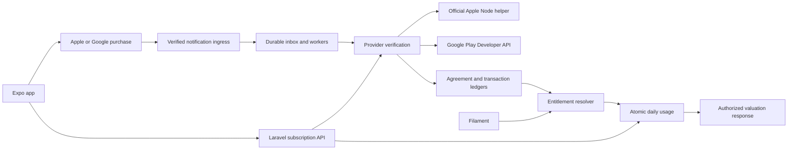
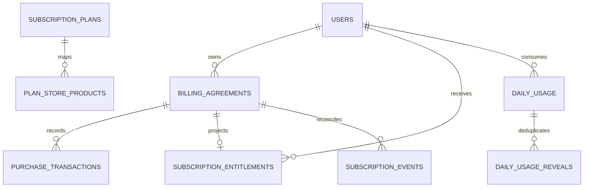

> Approved design from 21 October 2026. Local implementation and validation are tracked in the [execution register](08_PHASED_EXECUTION_PLAN.md). The user authorized local implementation on 22 October while keeping native/store acceptance and production activation gated.

### Architecture and dependency choices

Use **`expo-iap@6.1.1`** with its Expo config plugin and development builds. Current OpenIAP documentation supports Expo SDK 53+, but identifies SDK 57 as its validated baseline. Expo 54 therefore needs an explicit iOS/Android compatibility gate. Current `react-native-iap` targets bare React Native; it is not the chosen integration for this managed Expo application. [OpenIAP Expo setup](https://www.openiap.dev/docs/setup/expo), [package manifest](https://raw.githubusercontent.com/hyodotdev/openiap/main/libraries/expo-iap/package.json).

Use **`@apple/app-store-server-library@3.1.0`** in a private Node helper. Laravel retains all entitlement and database authority. Use the existing Google authentication and HTTP foundations for Play API access, promoting directly used dependencies into explicit requirements. [Apple server library](https://github.com/apple/app-store-server-library-node), [release 3.1.0](https://github.com/apple/app-store-server-library-node/releases/tag/v3.1.0).

Native store billing is the default for this app’s digital access. Regional external-payment programs require separate eligibility and enrollment work and are outside this release. [Apple review guidelines](https://developer.apple.com/app-store/review/guidelines/), [Google Payments policy](https://support.google.com/googleplay/android-developer/answer/9858738).

### Data model

Create nine tables; do not represent grants as successful payments.

| Table / proposed model | Purpose and essential constraints |
|---|---|
| `subscription_plans` / `SubscriptionPlan` | Stable key, tier key, duration months, service level, daily allowance, supported features, descriptions, visibility, active state, ordering, revision. |
| `plan_store_products` / `PlanStoreProduct` | Platform, product ID, Google base-plan ID, environment validation state, plan revision, expected metadata, last check and mismatch reason. Mapping identities are unique and never silently reassigned. |
| `billing_agreements` / `BillingAgreement` | User, provider, environment, original transaction/token-chain identity, renewal state, current provider state, verification timestamps, persistent local suppression. |
| `purchase_transactions` / `PurchaseTransaction` | Immutable verified transaction/order references, agreement, product, period, available amount/currency evidence, refund/revocation state. Unique provider/environment/transaction identity. |
| `subscription_entitlements` / `SubscriptionEntitlement` | Paid projection, administrative grant, or transition grant; start/end, feature/quota snapshot, actor/reason, revocation. At most one projection per agreement; multiple independent sources are allowed. |
| `subscription_events` / `SubscriptionEvent` | Durable provider inbox, deduplication key, processing state, attempts, timestamps, redacted error and correlation ID. |
| `subscription_audit_logs` / `SubscriptionAuditLog` | Append-only administrative/configuration history, actor, reason, affected record and before/after values. |
| `daily_usage` / `DailyUsage` | Unique user/environment/UTC-date bucket and used count. |
| `daily_usage_reveals` / `DailyUsageReveal` | Unique bucket/canonical-subject claim, preventing duplicate family charges. |

Use the existing numeric user foreign-key type and UUID item references. Add a stable, opaque billing-account UUID to users for Apple account binding; generate a non-identifying Google account binding from it.

Store purchase tokens and sensitive provider payloads encrypted; index fingerprints rather than raw tokens. Never expose them in Filament, mobile responses, or logs.

**Entitlement rules**

- Evaluate active account, validity interval `[startsAt, endsAt)`, revocation, environment, and feature rights.
- Highest valid allowance wins; unlimited wins over finite allowances. Never sum quotas.
- Paid and granted records remain independently visible. Revoking one source does not delete another valid source.
- Local suppression of a paid agreement survives renewal and reconciliation until explicitly lifted.
- Cancellation of renewal retains paid-through access. Expiration, effective revocation, account hold, or pause removes that source’s access. Provider-configured grace remains eligible.
- Use verified provider dates for paid periods. For administrative month durations, use calendar arithmetic without month overflow; custom UTC start/end dates remain available.
- Snapshot quota/features at initial agreement activation and explicit plan replacement. Renewals preserve that agreement’s benefits.

### Atomic reveal and leakage prevention

Introduce one explicit **POST valuation-reveal operation**. Serialization remains free of quota side effects.

1. Resolve a visible item and its canonical normalized serial family.
2. Calculate the existing valuation outside the quota transaction. Calculation failure consumes nothing.
3. Lock the user row, then re-evaluate entitlement and UTC date inside a transaction.
4. Obtain the daily bucket and check for an existing family claim.
5. Return an existing claim without incrementing, provided access is still valid.
6. Otherwise insert the claim and increment only when allowance remains.
7. Commit both changes together; return valuation and updated usage.

All grant/revoke/entitlement writers use the same user-first lock order. Unique indexes remain the final protection against retries and creation races.

After cutover, ordinary listing, home, detail, related-item, and saved-item responses contain **no restricted values**, including nested copies. Retain keys as nullable where compatibility requires it, add explicit access metadata, and stop converting missing prices into displayed zeroes. Audit free descriptions for structured valuation duplicates before release.

The reveal response uses existing pricing calculations, discount margins, currency handling, visibility rules, and unique-serial averaging. Do not rewrite pricing formulas.
